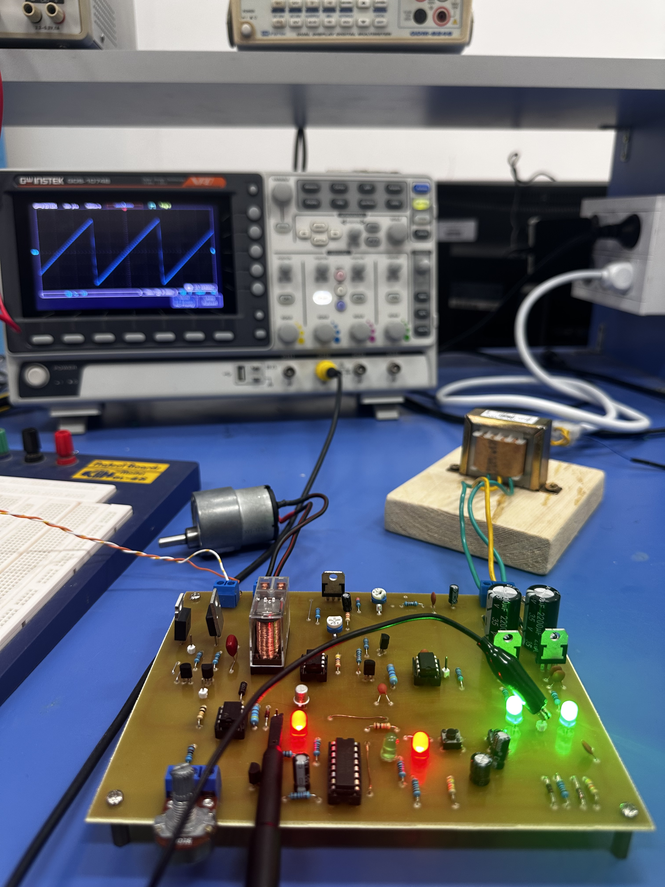
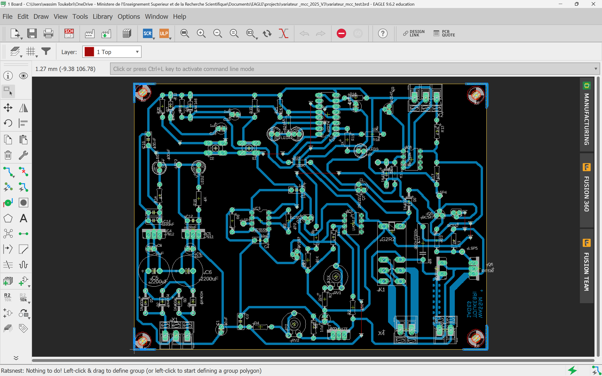
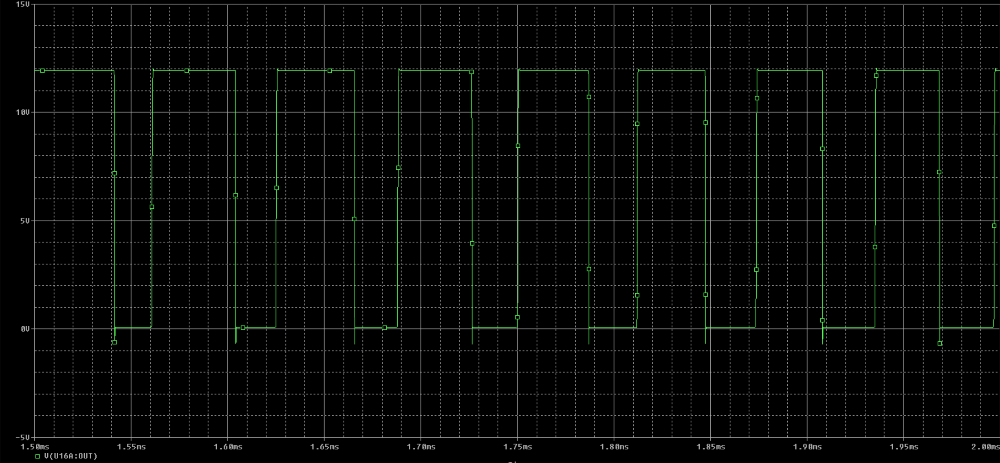
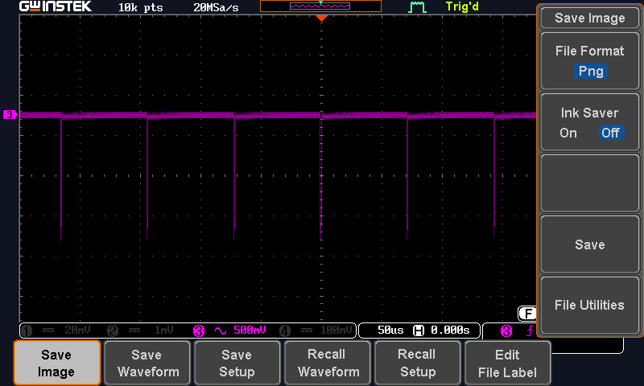
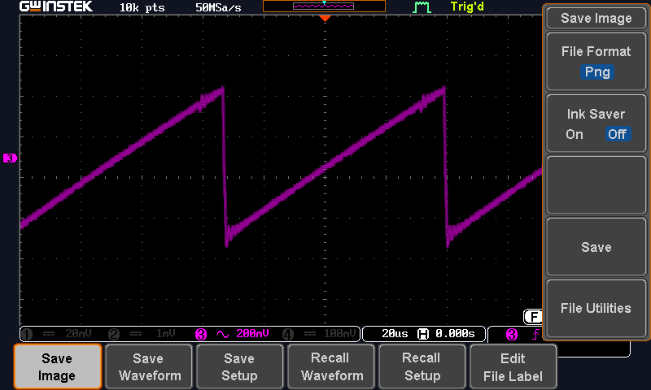

# PCB DC Motor Speed Controller

A PWM speed controller for a DC motor, designed in **EAGLE**, validated block by block in **PSpice**, and built as a home-etched PCB using UV photo-exposure.

Mini-project for *Électronique I* at the **École Nationale d'Ingénieurs de Tunis (ENIT)**, Electrical Engineering Department, 2025/2026.



## Features

- **Variable speed** through PWM, with the duty cycle set by a potentiometer
- **Start/stop** and **direction** control with two push buttons, latched by JK flip-flops
- **Direction reversal** by a DPDT relay that swaps the motor polarity
- **On-board ±12 V supply** from a 2×12 V transformer, plus an adjustable LM317T rail
- **Freewheeling diode** protecting the MOSFET from inductive voltage spikes
- Status LEDs and oscilloscope test points (LSP) on the board

## How it works

The circuit is split into a **control section** and a **power section**.

```
                 ┌───────────────── CONTROL ─────────────────┐
230 V AC ─► Transformer 2×12 V ─► Bridge (1N4004) ─► 2200 µF ─► 7812 / 7912 (±12 V)
                                                             └► LM317T (adjustable)

NE555N astable (~7 kHz ramp) ──┐
                               ├─► LM393N comparator ─► PWM ─► BC547/BC557 driver ─┐
µA741P speed setpoint (pot) ───┘                                                   │
                                                                                   ▼
                 ┌────────────────── POWER ──────────────────┐                   IRF530
External DC supply (X3) ─► C17 filter ─► Motor (X4) ◄── BYT08P freewheel diode ◄──┘

S1 ─► CD4027 JK (IC7A) ─► enables the MOSFET drive chain        (start / stop)
S2 ─► CD4027 JK (IC7B) ─► 2N2222 ─► G2R-2 relay ─► motor polarity (direction)
```

### Power supply

A 230 V / 2×12 V / 12 VA transformer feeds a 1N4004 full-wave bridge. Two 2200 µF capacitors smooth the output, and the 7812 and 7912 regulators produce stabilised +12 V and −12 V for the control electronics. An LM317T provides an adjustable rail for the reference circuit:

$$V_{out} \approx 1.25\left(1 + \frac{R_{V2}}{R_4}\right), \quad R_4 = 1\,\text{k}\Omega,\ R_{V2} = 470\,\Omega$$

### PWM generation

The NE555N (IC3) runs in astable mode. The 1N4148 diodes D5 and D6 steer the charge and discharge currents of C4 separately, producing a quasi-linear ramp at:

$$f = \frac{1.44}{(R_A + 2R_B)\,C} = \frac{1.44}{(470 + 2 \times 10\,000) \times 10\,\text{nF}} \approx 7\ \text{kHz}$$

The LM393N comparator (IC6) compares this ramp with the speed setpoint conditioned by the µA741P (IC1). The output is high while the setpoint is above the ramp, so turning the 10 kΩ potentiometer changes the duty cycle α and therefore the average motor voltage:

$$V_{avg} = \alpha \cdot V_{cc}, \qquad \alpha = \frac{t_{on}}{T}$$

### Control logic

The two JK flip-flops of a CD4027N (IC7) toggle on each button press:

| Flip-flop | Button | Function |
|-----------|--------|----------|
| IC7A | S1 | Start/stop. Its Q output enables the MOSFET drive chain |
| IC7B | S2 | Direction. Its Q output drives the relay through a 2N2222 (Q7) |

### Power stage

The IRF530 N-channel MOSFET (Q6) receives the PWM signal on its gate through BC547/BC557 driver transistors and switches the motor current. A BYT08P fast diode (D8) in antiparallel with the motor keeps the current flowing when the MOSFET turns off and clamps inductive spikes. The motor supply comes from an external DC source on terminal **X3**, filtered by C17 (330 nF / 100 V), and the motor connects to **X4**.

When IC7B sets Q = 1, the 2N2222 saturates, energises the Omron G2R-2 DPDT relay (K1), and the contacts reverse the polarity across the motor.

| Key part | Rating |
|----------|--------|
| IRF530 | 100 V, 14 A, R<sub>DS(on)</sub> 0.16 Ω, 75 W |
| BYT08P | 400 V, 8 A fast diode |
| G2R-2 | 12 V coil, DPDT, 5 A contacts |

## PCB design



- **Board size:** 120 × 160 mm, with a ground copper pour on the bottom layer (thermals on, orphans off)
- **Track widths** sized with the IPC chart for 1 oz copper and ΔT = 10 °C:

  | Current | Width | Used for |
  |---------|-------|----------|
  | 1 A | 0.25 mm (10 mil) | Logic signals (CD4027N, LM393N) |
  | 2 A | 0.76 mm (30 mil) | General signal tracks |
  | 3 A | 1.27 mm (50 mil) | ±12 V control supply |
  | 4 A | 2.03 mm (80 mil) | Power tracks (IRF530, BYT08P) |
  | 5 A | 2.79 mm (110 mil) | Rectifier bridge |

- **Layout rules:** 45° corners only, at most 10 jumpers (each under 2 cm and not crossing tracks), 40 % pad restring, analog/digital/power areas physically separated
- **Thermal:** IRF530, LM317T, 7812 and 7912 (all TO-220) placed on the board edge so heatsinks can be fitted
- **DRC:** 40 mil clearances and minimum track width, 0.7 mm minimum drill

## Fabrication

1. **UV exposure** of a presensitised epoxy board through the printed transparency (typon)
2. **Developing** in sodium hydroxide (NaOH) to remove the unexposed resist
3. **Etching** in ferric chloride (FeCl₃); the ground pour reduces the copper to remove
4. **Drilling** and **soldering** of the through-hole components
5. **Continuity test** with a multimeter before power-up
6. **Functional test:** supply check, then motor connected and the PWM observed on the LSP test points with an oscilloscope

## Results

| PSpice: PWM signal | Oscilloscope: LSP1 | Oscilloscope: LSP2 |
|:---:|:---:|:---:|
|  |  |  |

More simulation results (power supply, ramp, start/stop, power stage) and measurements are in the [full report](rapport_WASSIM_TOUKEBRI.pdf).

## Bill of materials

<details>
<summary>Full component list</summary>

| Reference | Value | Package | Description |
|-----------|-------|---------|-------------|
| C1, C7 | 10 µF | E2,5-5 | Polarised capacitor |
| C2 | 1 nF | C050-030X075 | Ceramic capacitor |
| C3, C11, C12, C14, C15 | 100 nF | C050-030X075 | Ceramic capacitor |
| C4 | 10 nF | C050-030X075 | Ceramic capacitor (timing) |
| C5, C6 | 2200 µF | E5-13 | Electrolytic capacitor |
| C8, C9, C10, C13, C16 | 1 µF | E2,5-5 | Polarised capacitor |
| C17 | 330 nF / 100 V | C150-054X183 | Polyester capacitor |
| D1–D4, D9 | 1N4004 | DO41-10 | Rectifier diode 400 V / 1 A |
| D5, D6, D7 | 1N4148 | DO35-10 | Fast signal diode |
| D8 | BYT08P | TO220ACS | Fast freewheeling diode |
| IC1 | µA741P | DIL08 | Op-amp |
| IC2 | LM317T | 317TS | Adjustable regulator |
| IC3 | NE555N | DIL08 | Timer / oscillator |
| IC4 | 7812 | 78XXS | +12 V regulator |
| IC5 | 7912 | 79XXS | −12 V regulator |
| IC6 | LM393N | DIL08 | Dual comparator |
| IC7 | CD4027N | DIL16 | Dual JK flip-flop (CMOS) |
| K1 | G2R-2 | G2R2 | 12 V DPDT relay |
| LED1, LED2, LED4 | Green | LED5MM | Status LED |
| LED3, LED5 | Red | LED5MM | Alarm / direction LED |
| Q1, Q2, Q4 | BC557 | TO92 | PNP signal transistor |
| Q3, Q5 | BC547 | TO92 | NPN signal transistor |
| Q6 | IRF530 | TO220BV | N-channel power MOSFET |
| Q7 | 2N2222 | TO18 | NPN switching transistor |
| R1 | 4.7 kΩ | 0207/10 | Resistor |
| R2 | 15 kΩ | 0207/10 | Resistor |
| R3 | 22 kΩ | 0207/10 | Resistor |
| R4, R14, R15, R19, R24 | 1 kΩ | 0207/10 | Resistor |
| R5 | 220 Ω | 0207/10 | Resistor |
| R6, R7, R8, R12, R16, R17, R18, R21, R23, R25 | 10 kΩ | 0207/10 | Resistor |
| R9, R11 | 470 Ω | 0207/10 | Resistor |
| R10, R20 | 47 kΩ | 0207/10 | Resistor |
| R13 | 6.8 kΩ | 0207/10 | Resistor |
| R22 | 10 Ω | 0207/10 | Current sense resistor |
| RV1 | 2.2 kΩ | LI10 | Trimmer |
| RV2 | 470 Ω | LI10 | Trimmer |
| S1, S2 | — | B3F-10XX | Omron push button |
| X1, X2 | — | AK300/3 | 3-way terminal block |
| X3, X4 | — | AK300/2 | 2-way terminal block |

</details>

## Repository structure

```
rapport_WASSIM_TOUKEBRI.pdf   Full project report (French)
rapport/                      LaTeX source of the report, figures, schematic,
                              placement and copper-layer PDFs, parts list
simulation/                   PSpice simulations (power supply, ramp, MOSFET stage,
                              start/stop logic, capacitor charge)
lm555n/                       NE555 astable simulations and datasheet
78XX/ 79XX/ LM393/ *.PDF      Component datasheets
MP_Electronique_2025_*.pdf    Project schematic and component list
final tempo/                  Timer board: technical file, schematic, layout
tempo_2026-02-10/             Timer board CAM outputs (Gerber and drill files)
```

## Tools

- **Autodesk EAGLE:** schematic capture, PCB layout, Gerber generation
- **Cadence PSpice:** circuit simulation
- **LaTeX:** report

## Author

**Wassim Toukebri**, 1st year Electrical Engineering, ENIT

Supervised by **M. Joseph Haggege** and **M. Wissem Naouar**.

Thanks to the ENIT electronics lab technicians and to **Jasser Mhamdi** for his help.
